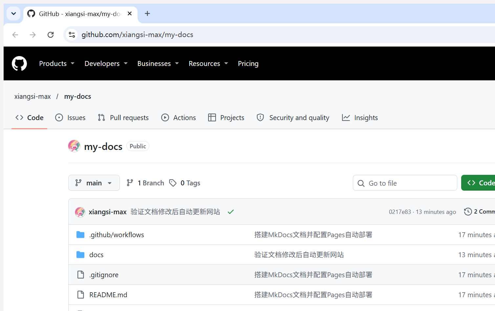
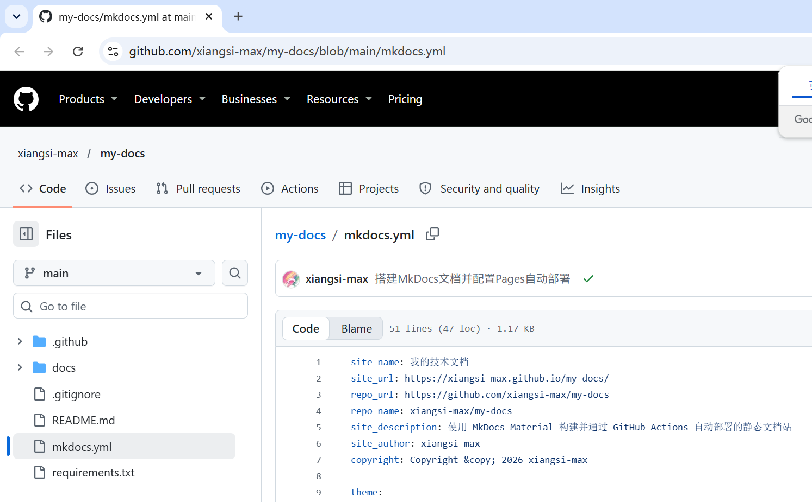
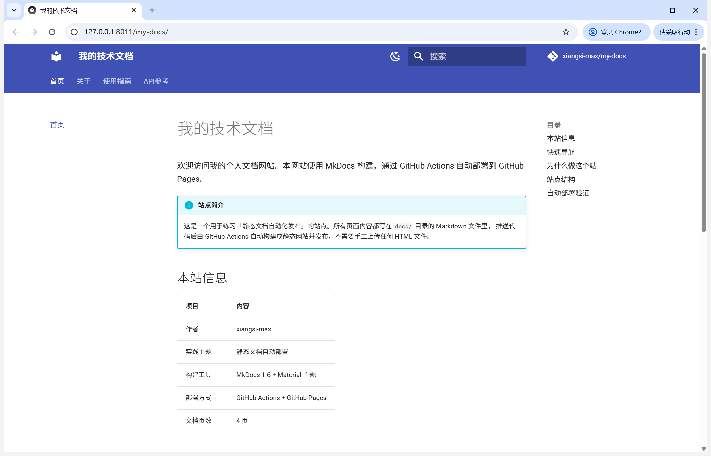
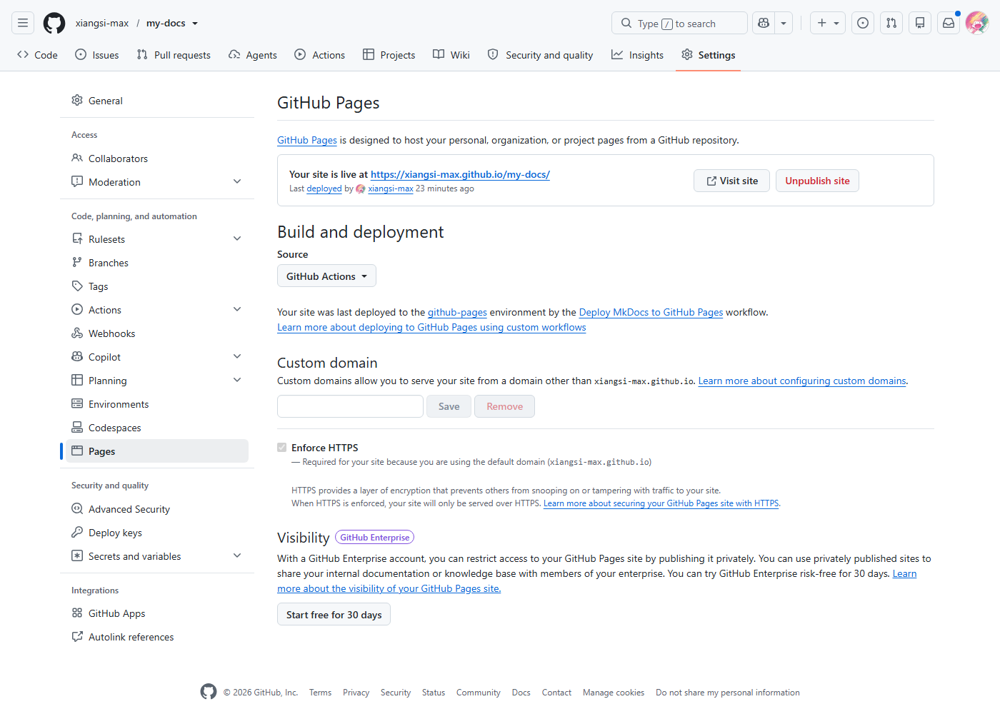
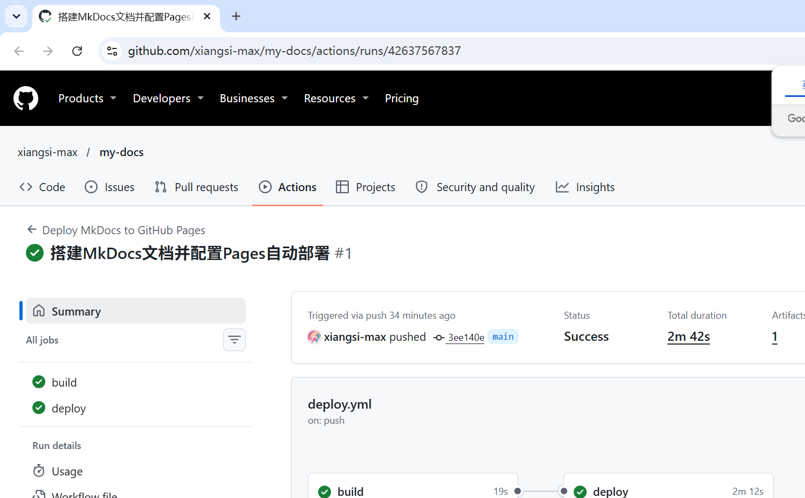
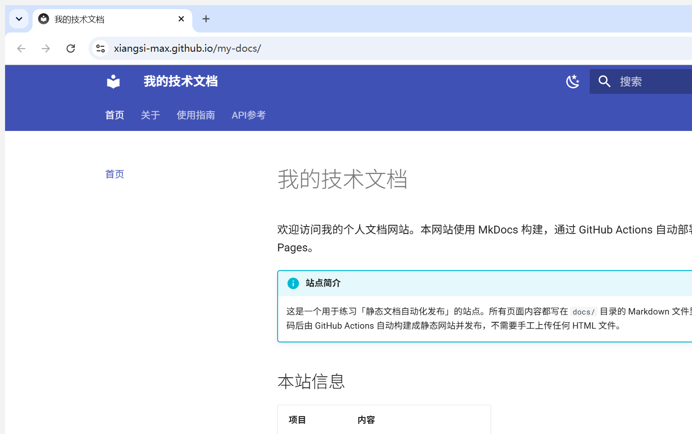
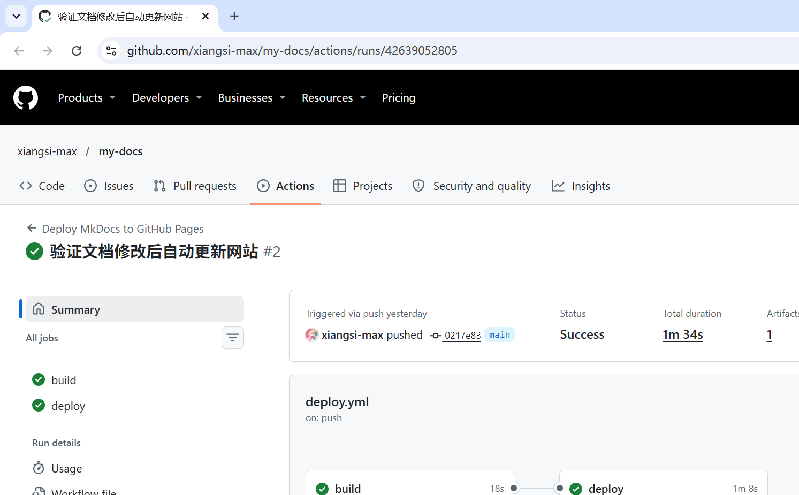

# 实践项目2：个人实验报告

## 1. 基本信息

- **姓名拼音**：luoweicheng
- **GitHub 登录名**：xiangsi-max
- **个人仓库地址**：https://github.com/xiangsi-max/my-docs
- **最终网站地址**：https://xiangsi-max.github.io/my-docs/
- **教师仓库 Issue**：[#90 02-github-pages luoweicheng](https://github.com/hunnuOpenSourceSoftware2026/assignments/issues/90)
- **实践主题**：用 MkDocs 编写静态文档，交给 GitHub Actions 自动构建并发布到 GitHub Pages

我这次没有手工往任何服务器上传过一个 HTML 文件。网站每一次「发布」（首次上线、第二次内容更新、第三次补充页面链接）全部由 `git push` 触发，三次运行都在 Actions 里留下了记录。而后来只推报告的提交则一次运行都没产生——这个对比恰好说明了触发条件是精准的。

---

## 2. 实践过程与关键截图

### 2.1 仓库创建

**做了什么**：用本人账号新建公开仓库 `my-docs`，默认分支 `main`，然后把本地写好的源码推送上去。

**为什么这样做**：Pages 站点必须是公开可访问的，私有仓库的 Pages 需要付费计划；而工作流里写死了 `branches: [main]`，如果默认分支叫 `master`，后面 push 根本不会触发。

**结果**：仓库首页可见 `Public` 标识、所有者 `xiangsi-max`、仓库名 `my-docs`，右侧 About 里填了站点地址。



> 截图说明：地址栏是 `github.com/xiangsi-max/my-docs`，仓库名下方能看到 `Public` 徽标——这是验收里明确要求的第一项。

### 2.2 项目结构与 MkDocs 配置

**做了什么**：按作业要求的目录结构建立文件，`mkdocs.yml` 里写死站点名、`site_url`、导航和 Material 主题。



三层目录的分工，我是这样理解的：

| 位置 | 保存什么 | 谁修改 |
| --- | --- | --- |
| `docs/` | 四页 Markdown 源文件 | 我手工写 |
| `mkdocs.yml` | 站点名、导航顺序、主题、扩展 | 我手工写 |
| `site/` | 构建出来的 HTML、CSS、JS | **机器生成，我从不碰** |

`nav` 里的路径是**相对 `docs/`** 的，所以写 `index.md` 而不是 `docs/index.md`。这一点我一开始差点写错，`mkdocs build --strict` 会直接报"文件不存在"把它拦下来。

`site/` 和 `.venv/` 都进了 `.gitignore`。理由很直接：它们是本地运行产生的中间物，体积大、每次构建都变，提交进去只会让 diff 变脏，而且和工作流里"重新构建一份"完全重复。

### 2.3 本地构建与预览

**做了什么**：建虚拟环境、装依赖、严格构建、本地预览。

```bash
python -m venv .venv
source .venv/Scripts/activate          # Windows Git Bash
python -m pip install -r requirements.txt
python -m mkdocs build --strict
python -m mkdocs serve --dev-addr 127.0.0.1:8011
```



**检查了哪些内容**：

1. 顶部导航四个入口「首页 / 关于 / 使用指南 / API参考」都能点进去，页面标题正确对应；
2. 每页的表格渲染成了真正的表格（边框、表头对得上），不是竖线堆在一起；
3. 代码块有语法高亮和复制按钮；
4. 页面之间的链接能跳转，没有 404；
5. 右侧目录（TOC）能跟随滚动高亮。

> 这里有个容易踩的点：因为 `site_url` 带了子路径 `/my-docs/`，`mkdocs serve` 实际的服务地址是 `http://127.0.0.1:8011/my-docs/`，**末尾的 `my-docs/` 不能省**，直接访问根路径会 404。

### 2.4 Pages 发布来源设置

**做了什么**：`Settings` → `Pages` → `Build and deployment` → `Source` 选 **GitHub Actions**。

**为什么这样做**：作业明确要求走官方 Pages Actions 方案。如果选成 "Deploy from a branch"，GitHub 会自己去找 `gh-pages` 分支，那我们的工作流就没有意义了——它会一直报"找不到分支"。



截图里能看到 "Your site is live at https://xiangsi-max.github.io/my-docs/"，以及 "last deployed ... by the Deploy MkDocs to GitHub Pages workflow"，说明发布来源确实绑定到了我们的工作流上。

### 2.5 Actions 首次构建与部署

**做了什么**：把源码提交推送到 `main`，工作流自动触发。

- 提交：`3ee140e` [搭建MkDocs文档并配置Pages自动部署](https://github.com/xiangsi-max/my-docs/commit/3ee140e8e1b2748d3b535f71e45ffde7d358428b)
- 运行：#1 https://github.com/xiangsi-max/my-docs/actions/runs/42637567837



**结果**：`build` 与 `deploy` 两个任务都是绿色。时间线（UTC）：

| 任务 | 开始 | 结束 | 耗时 |
| --- | --- | --- | --- |
| build | 14:44:12 | 14:44:31 | 约 19 秒 |
| deploy | 14:44:37 | 14:46:49 | 约 2 分 12 秒 |

build 只花了不到 20 秒，大部分时间花在 deploy——因为这一步要真正把产物推到 Pages 的 CDN 并等待生效。

### 2.6 网站访问与四页导航检查



四个页面逐一打开确认：

| 页面 | 地址 | 状态 |
| --- | --- | --- |
| 首页 | https://xiangsi-max.github.io/my-docs/ | 200 |
| 关于 | https://xiangsi-max.github.io/my-docs/about/ | 200 |
| 使用指南 | https://xiangsi-max.github.io/my-docs/guide/ | 200 |
| API 参考 | https://xiangsi-max.github.io/my-docs/api/ | 200 |

截图保留了完整地址栏，可以看到域名是 `xiangsi-max.github.io/my-docs/`，**带上了仓库路径**——项目站点必须带这段前缀，漏掉就 404。

### 2.7 第二次推送与自动更新验证

**做了什么**：在 `docs/index.md` 末尾加一句话，提交推送，**全程没有点任何手动部署按钮**。

```markdown
## 自动部署验证

自动部署验证：这是我第二次推送后更新的内容。
```

- 提交：`0217e83` [验证文档修改后自动更新网站](https://github.com/xiangsi-max/my-docs/commit/0217e83266141048c3ef6195d3dc220c43ab6767)
- 运行：#2 https://github.com/xiangsi-max/my-docs/actions/runs/42639052805



| 任务 | 开始 | 结束 | 耗时 |
| --- | --- | --- | --- |
| build | 14:53:15 | 14:53:33 | 约 18 秒 |
| deploy | 14:53:38 | 14:54:46 | 约 1 分 08 秒 |

push 后约 2 秒就开始跑了（14:53:13 创建，14:53:15 起 build），说明 `on.push` 的监听是即时生效的。

刷新公开网站后，新增的文字出现了：


到这里"推送 → 构建 → 部署 → 网页更新"这条链路被完整验证了一遍。整个过程我只做了一件事：改了一个 Markdown 文件然后 push。

### 2.8 第三次推送：补充页面间链接

自查时我发现一个问题：作业要求四页都含页面间链接，但我最初只在首页写了指向另外三页的链接，`about` / `guide` / `api` 三页是"被链接"但没有"链回去"。虽然勉强能用顶部导航代替，但严格按字面要求是不达标的。

于是我给三页各加了一个「相关页面」小节，互相之间全部连上：

```markdown
## 相关页面

- [首页](index.md)——站点信息概览与快速导航。
- [关于本项目](about.md)——技术选型与目录职责说明。
- [使用指南](guide.md)——本地预览、严格构建与推送流程。
```

- 提交：`bb0c4f8` [补充三页的页面间链接](https://github.com/xiangsi-max/my-docs/commit/bb0c4f830d922e481928d8978a60d2ae483442ac)
- 运行：#3 https://github.com/xiangsi-max/my-docs/actions/runs/42651682474
- 结果：build 与 deploy 均 success

这次推送**再次自动触发了**工作流，说明第 2 次不是偶然。上线后我验证了三页都出现了新增的「相关页面」区块：

```text
/about/  含「相关页面」3 处
/guide/  含「相关页面」3 处
/api/    含「相关页面」3 处
```

### 2.9 反证实验：只改报告会怎样

为了给第 4 问一个**实测答案**而不是纸面推理，我做了这个对照实验：提交 `0870b6b` [报告补充第三次推送与反证实验记录](https://github.com/xiangsi-max/my-docs/commit/0870b6b9bf68c373d5096288bdfc137b99eb76b4) **只**包含 `report/README.md`（就是你正在读的这一段），不碰任何 `docs/` 下的文件，推上去之后观察 Actions。

推送前运行数是 3 次，推送后等了 90 秒再看：

| 时间点 | 工作流运行数 |
| --- | --- |
| 推送前 | 3 |
| 推送 `0870b6b` 后 90 秒 | **3** |

**没有新增运行。** GitHub 在收到 push 后比对了改动文件列表，`report/README.md` 没有命中 `paths` 里的任何一条，于是直接没有创建工作流运行——连"跳过"的记录都没留下，因为它压根没启动。

这个反证让第 4 问从"读配置推断"变成了"实测确认"：`paths` 过滤是生效的，不是碰巧没跑。

---

## 3. 问题与解决

### 问题 1：`git push` 卡住不动，没有任何提示

**现象**：执行 `git push origin main` 后终端长时间无输出，也不报错，就是挂着。

**原因**：本机 Git 的凭据助手没有为 `github.com` 配置好，push 时它在后台等待一个永远不会出现的凭据输入。

**解决**：用 `gh auth setup-git` 把 GitHub CLI 注册成 git 的凭据助手，之后 push 直接成功，不再弹窗。关键是这个顺序——**先让 `gh` 登录成功，再让它接管 git 凭据**，而不是手写 token。

### 问题 2：`mkdocs build` 生成了一个多余的临时目录被误提交

**现象**：`git status` 里冒出一个 `mkdocs_al2hgu6m/` 目录，已经进了暂存区。

**原因**：MkDocs 构建时会临时创建目录，构建结束本应清理；某些情况下残留了下来，而 `.gitignore` 当时只写了 `site/`，没覆盖这种名字带随机串的目录。

**解决**：

```bash
git rm -r --cached mkdocs_al2hgu6m
rm -rf mkdocs_al2hgu6m
```

并在 `.gitignore` 里补上 `mkdocs_*/`。教训是：`.gitignore` 要按**模式**写，而不是只写死自己见过的那个目录名。

### 问题 3：截 GitHub 需要登录的页面一直失败

**现象**：Actions 运行页和 Settings → Pages 页，用普通无头浏览器截出来是全白/全黑。

**原因**：这两个页面需要登录态，匿名访问会被重定向；而浏览器的登录 cookie 绑定在本机真实 profile 上，复制一份 profile 到别处并不生效（cookie 是加密的，换了 profile 就解不开）。

**解决**：改用本机已登录的 Chrome profile 来跑无头截图，就拿到了真实页面。

### 没有遇到但核对过的地方

`build --strict` 在本地一直是 0 警告通过的，所以没有出现"线上构建失败但本地正常"这种最麻烦的情况。我额外确认了三件事：`requirements.txt` 里的版本范围在 CI 的 Python 3.12 上能装（本地是 3.11，版本范围留了余量）；工作流里 `path: site` 和本地 `mkdocs build` 的默认输出目录一致；`upload-pages-artifact@v4` 的 `path` 是**目录**而不是单个文件。

---

## 4. 原理理解

### 4.1 docs/ 和 site/ 各保存什么？为什么不用手工修改 site/？

`docs/` 是**源文件**，是我手写的 Markdown，人可读、可以 diff、可以 review。`site/` 是**构建产物**，是 MkDocs 把 Markdown 加主题模板、加导航结构、加搜索索引之后生成的完整 HTML/CSS/JS 目录，机器生成、内容冗长、每次构建都可能变。

不手工改 `site/` 有三个理由：

1. **会被覆盖**。每次 `mkdocs build` 都从头重新生成，手改的部分下一次构建就没了。
2. **改了也没意义**。`site/` 在 `.gitignore` 里，根本不进仓库，工作流是在 CI 里重新构建一份上传的，本地那份改得再漂亮也传不到线上。
3. **它是单向产物**。Markdown → site 是单向转换，反着从 HTML 改回 Markdown 才是真的工作量大。

一句话：`docs/` 是要维护的资产，`site/` 是可以随时丢弃重算的缓存。

### 4.2 本次工作流在什么情况下自动运行？

三种情况，前两种是自动的：

1. **向 `main` 分支 push，且改动的文件命中 `paths` 列表**——即 `docs/**`、`mkdocs.yml`、`requirements.txt`、`.github/workflows/deploy.yml` 之一。
2. **工作流文件本身被修改并推送**，同样因为它在 `paths` 里。
3. **手动触发**：`workflow_dispatch` 允许在 Actions 页面点 "Run workflow"，这条用于首次重试和排错。

不满足 `paths` 的 push（比如只改 `README.md`）不会触发。这正是后面第 4 问的基础。

### 4.3 build 与 deploy 两个任务有什么区别？

**build 是"生产"，deploy 是"发布"。**

| | build | deploy |
| --- | --- | --- |
| 运行环境 | `ubuntu-latest` | `ubuntu-latest` |
| 权限 | 继承顶层 `contents: read` | 额外要 `pages: write` + `id-token: write` |
| 做什么 | checkout 源码 → 装 Python 3.12 → 装依赖 → `mkdocs build --strict` → 把 `site/` 打包成 artifact 上传 | 下载 artifact → 交给 Pages 服务发布 |
| 产出 | 一个 artifact | 线上可访问的网站 |
| 失败影响 | deploy 根本不会启动 | 网站保持旧版本 |

关键在 `needs: build`：**deploy 必须等 build 成功才开始**。如果 Markdown 里有死链、`nav` 指向不存在的文件，`--strict` 让 build 失败，deploy 就被跳过，线上始终是上一次成功的版本——这就是为什么线上站点不会因为一次错误提交而变成白屏。

权限拆开也是同一个思路：build 只需要读代码，**不该有写 Pages 的能力**；只有 deploy 需要 `pages: write`。这是最小权限原则，即使 build 阶段的依赖被投毒，它也动不了已发布的网站。

### 4.4 只修改 report/README.md 会触发部署吗？为什么？

**不会。**

因为 `on.push.paths` 里只有 `docs/**`、`mkdocs.yml`、`requirements.txt`、`.github/workflows/deploy.yml` 这四项，`report/**` 不在其中。GitHub 在收到 push 后会先比对这次提交改动的文件列表，没有命中就直接不创建工作流运行。

这个设计是合理的：`report/` 只是作业过程记录，不参与网站构建。如果改报告也触发部署，等于每次写报告都要白白跑一遍构建和发布，浪费额度，还会让 Actions 历史里混进一堆"没有改变网站内容"的运行记录。

**这条我实测过**，见 [2.9 反证实验](#29-反证实验只改报告会怎样)：只推 `report/README.md` 的提交 `0870b6b` 推上去 90 秒后，工作流运行数仍然是 3，没有多出第 4 次。

反过来说，如果想让报告也触发，只要在 `paths` 里加上 `report/**` 即可——但没必要。

### 4.5 本次方案为何无需创建 gh-pages 分支？

因为**托管的载体变了**。

传统做法是：CI 构建出 `site/`，然后把这个目录的内容强制推送到一个叫 `gh-pages` 的分支上，再由 Pages 去读那个分支的根目录。这样做需要：一个专门的分支、对仓库的写权限（`contents: write`）、以及一次 `git push`。

这次用的是官方 Pages Actions 方案，链路是：

```text
源码 → build 任务产出 artifact（一个 tar 包）
     → deploy 任务把 artifact 直接交给 Pages 服务
     → Pages 发布（不需要经过任何分支）
```

`upload-pages-artifact@v4` 把 `site/` 打包成 **artifact**（存在 Actions 的运行记录里，不是分支），`deploy-pages@v4` 拿着 `id-token` 换取一个短期 OIDC 令牌，直接调用 Pages 的部署接口。所以：

- 不需要 `gh-pages` 分支，产物压根没进 git；
- 不需要 `contents: write`，因为不往仓库写任何东西；
- 不需要长期 PAT，因为身份认证靠 `id-token: write` 给的**一次性**令牌。

这也顺带回答了为什么 Pages 的 Source 必须设成 "GitHub Actions" 而不是 "Deploy from a branch"——后者对应的正是已经被淘汰的那条分支发布链路。

---

## 5. 提交前自查

- [x] 使用本人账号 `xiangsi-max` 的公开仓库，未借用他人运行记录
- [x] 默认分支为 `main`，与工作流 `branches: [main]` 一致
- [x] 所有示例账号、仓库地址均已替换为本人信息
- [x] 四个 Markdown 均为 UTF-8，YAML 全部使用空格缩进
- [x] 四页均有标题与实质内容，包含表格、代码块、页面间链接和本人撰写的介绍与体会
- [x] Pages 发布来源为 **GitHub Actions**，未创建 `gh-pages` 分支
- [x] 工作流保留原始 `${{ }}` 表达式，未替换成账号
- [x] 首次运行与第二次 push 均成功，线上已出现新增文字
- [x] 四页两两互链（第三次推送补上了 about/guide/api 的「相关页面」小节）
- [x] 仅改报告的提交已实测确认不触发部署
- [x] `site/`、`.venv/` 未提交，仓库中无构建产物
- [x] 已在教师仓库提交一条 Issue
